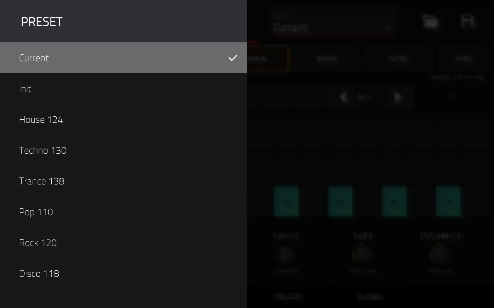
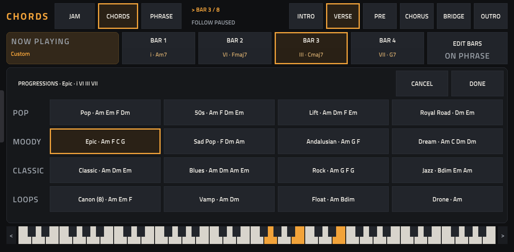
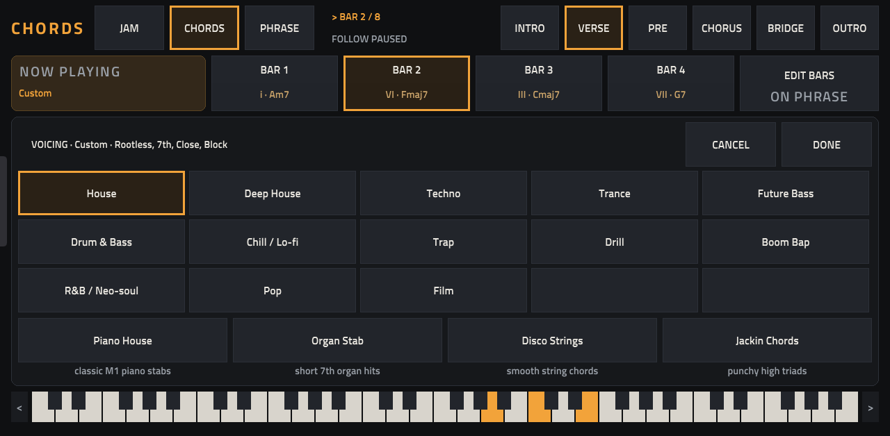
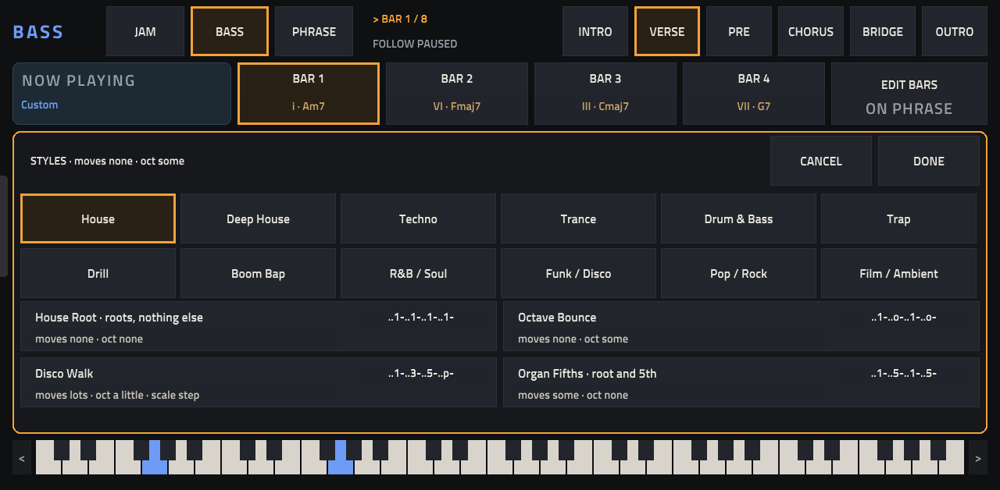
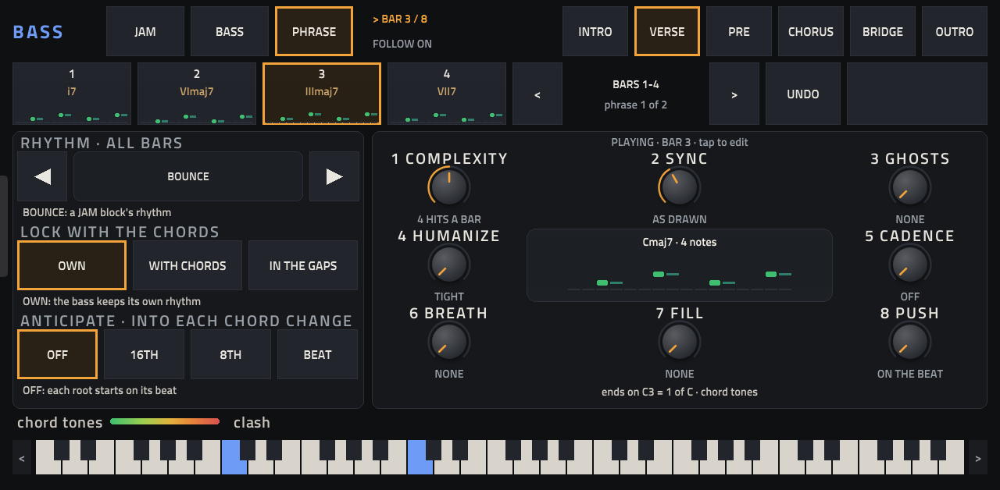
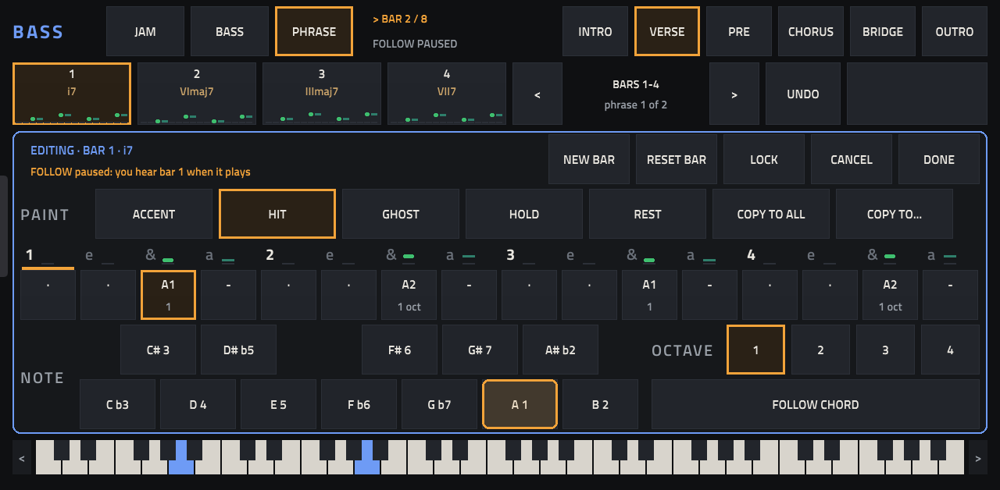
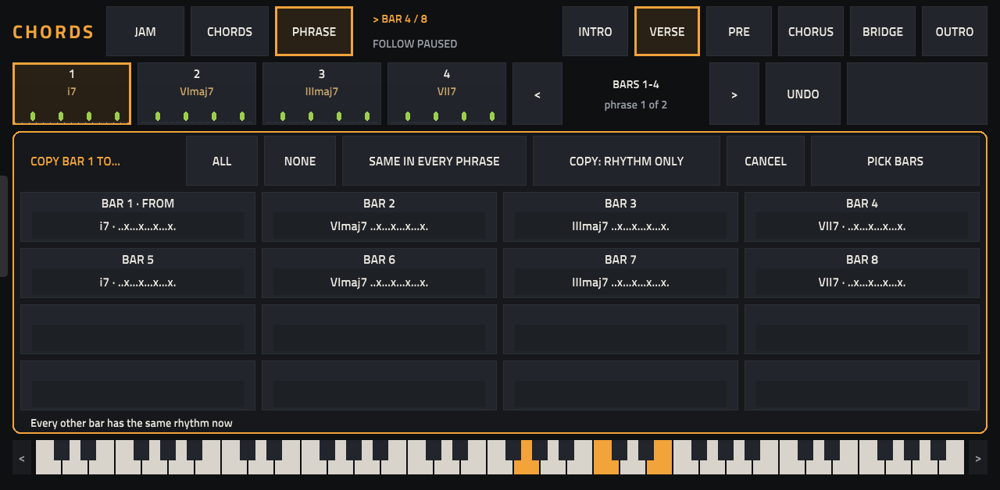
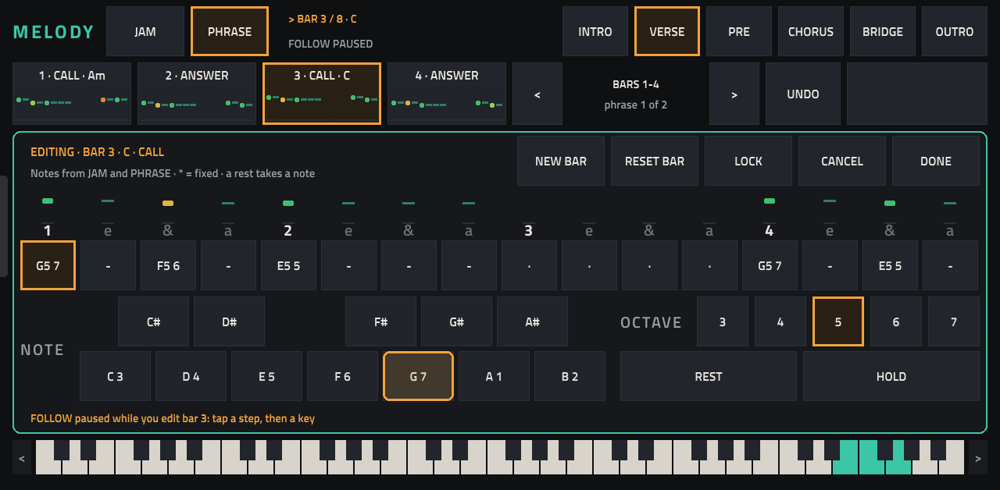
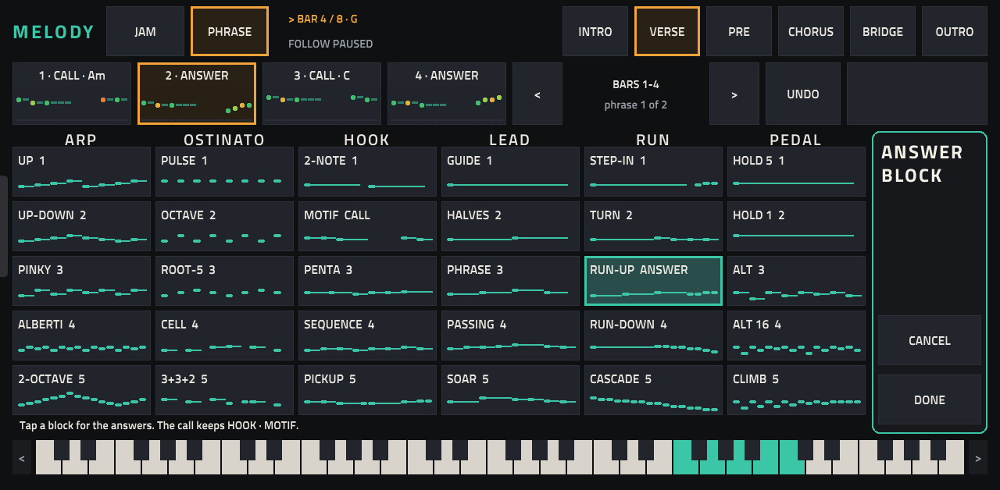

# Cadenza 0.26.0 — The Manual

Everything Cadenza does, every page, every control and every knob, in one place. Read it from the top the first time,
then use it as a reference. The [cheat sheet](#22-cheat-sheet) at the end puts it all on one page.

Cadenza is a chord-driven generative MIDI sequencer for the Akai Force, as a native VST2 plugin. It was called Chord Seq
until 0.25.0. The project page is [README.md](README.md); [cadenzajam.com](https://cadenzajam.com) has a setup
walkthrough and the browser version.

---

## How to read this manual

| Written | Means |
| --- | --- |
| **tap JAM** | touch JAM on the Force's screen and let go. A quick tap works best; a long press can only highlight. |
| **knob 3** | the third of the Force's eight Q-Link knobs (top row, left to right). On screen the eight knobs are numbered the same way. |
| **◀ ▶** | the arrow cells either side of a field: step to the previous or next value. Most wrap around. |
| **lane** or **part** | one of the three things Cadenza plays: **Chords**, **Bass** or **Melody**. |
| **song part** | one of the six sections: **INTRO**, **VERSE**, **PRE**, **CHORUS**, **BRIDGE**, **OUTRO**. |
| **bar**, **step** | the loop is 1 to 16 bars, and each bar has 16 steps (16th notes). |
| **hit** | a step where a lane plays. A hit is an ACCENT, a HIT or a GHOST, and can be held (HOLD). |

The colours on screen always mean the same lane: **amber** is Chords, **blue** is Bass, **green** is Melody.

The screenshots were taken on a Force running Cadenza 0.26.0, playing the House 124 preset.

---

## Contents

- [What's new in 0.26](#whats-new-in-026)

1. [What Cadenza is](#1-what-cadenza-is)
2. [Install, upgrade, uninstall](#2-install-upgrade-uninstall)
3. [Set up a project](#3-set-up-a-project)
4. [Your first groove in 60 seconds](#4-your-first-groove-in-60-seconds)
5. [The big ideas](#5-the-big-ideas)
6. [The screen](#6-the-screen)
7. [PLAY](#7-play)
8. [GLOBAL](#8-global)
9. [Presets](#9-presets)
10. [Song parts and mutes](#10-song-parts-and-mutes)
11. [JAM pages](#11-jam-pages)
12. [The CHORDS page](#12-the-chords-page)
13. [The BASS page](#13-the-bass-page)
14. [PHRASE on CHORDS and BASS](#14-phrase-on-chords-and-bass)
15. [The bar editor on CHORDS and BASS](#15-the-bar-editor-on-chords-and-bass)
16. [MELODY PHRASE: call and answer](#16-melody-phrase-call-and-answer)
17. [The MELODY bar editor and ANSWER BLOCK](#17-the-melody-bar-editor-and-answer-block)
18. [Every page, knob by knob](#18-every-page-knob-by-knob)
19. [Saving, loading and UNDO](#19-saving-loading-and-undo)
20. [Timing: how Cadenza follows MPC](#20-timing-how-cadenza-follows-mpc)
21. [Troubleshooting](#21-troubleshooting)
22. [Cheat sheet](#22-cheat-sheet)

Reference: [progressions](#a-progressions) · [scales and borrowed chords](#b-scales-and-borrowed-chords) ·
[voicing styles](#c-voicing-styles) · [bass styles](#d-bass-styles) · [rhythms](#e-rhythms)

---

## What's new in 0.26

**Each song part keeps its own mutes.** Mute the Bass in the INTRO and it stays muted there while the VERSE and CHORUS
play it.

- A tap on a lane's name on PLAY mutes that lane **in the playing part only**.
- A part you queue while playing brings its own mutes in at the bar line where it starts.
- A part used for the first time copies the VERSE's mutes, along with the rest of the VERSE.
- UNDO never changes a mute.
- Projects saved before 0.26 load as they played: their mutes apply to every part until you change one.

---

## 1. What Cadenza is

Cadenza writes and plays three lanes, **Chords**, **Bass** and **Melody**, and sends them as MIDI to three other tracks on
your Force. It makes no sound itself; the tracks it drives make the sound, so any instrument works: a stock synth, a
drum or sample program, another plugin, or external gear through the Force's MIDI out.

It is built around three ideas:

- **The chords lead.** You set a key, a scale and a progression. The bass and the melody always follow the chord that is
  playing: borrowed chords, sus chords and chord changes in the middle of a bar included.
- **You steer, it writes.** You pick blocks and turn knobs that say what they do (*6 HITS A BAR*, *ROOT AND 5TH*,
  *SWING 8TH 58%*), and Cadenza writes the notes. Then, if you like, you edit any bar, hit by hit.
- **Nothing is random.** The same blocks, knobs and edits always give the same notes. A project you reload plays exactly
  as it did when you saved it.

---

## 2. Install, upgrade, uninstall

You need:

- An **Akai Force** (first generation) with MPC OS 3.x. Cadenza is tested on a Force with MPC OS 3.9.1. The installer
  also accepts the other first-generation MPC OS devices (MPC Live, Live II, One, X, Key 61), but they are untested.
- **Root SSH access** to the device, which needs a modded unit (for example MockbaMod). Installing plugins this way is
  unofficial: back up first, and use it at your own risk.

### Install

1. Download `Cadenza-0.26.0-mpc-armv7.zip` and unzip it on your computer.
2. **Save your project.** The installer stops MPC and starts it again.
3. Copy the folder to the device and run the installer:

   ```
   scp -r Cadenza-0.26.0 root@<device-ip>:/tmp/
   ssh root@<device-ip> sh /tmp/Cadenza-0.26.0/install.sh
   ```

The installer checks the device, stops MPC, copies the plugin folder to `/sdcard/Synths/Cadenza - VST - Cadenza/`,
backs up `MPC.settings`, adds Cadenza to MPC's plugin list and starts MPC again. Add `-y` to skip its confirmation
question. The zip's `INSTALL.md` has the steps for installing by hand.

### Upgrade

Run the new version's installer the same way; it upgrades in place. Then:

- **Test a new version in a new project.** MPC saves each plugin's Q-Link map in the project and replays it, so a
  project saved with an older version can show old knob names. Your old projects still load and play.
- **Upgrading from Chord Seq (0.24 or older):** the plugin is now listed as **VST › Cadenza** and its MIDI port is
  **Cadenza MIDI Out**. The installer replaces the old Chord Seq entry. Pick **Cadenza MIDI Out** again as the input
  port on each track it drives.

### Uninstall

`ssh root@<device-ip> sh /tmp/Cadenza-0.26.0/uninstall.sh` removes the plugin folder and its entry in the plugin list,
and restarts MPC. Projects that use Cadenza load without it.

---

## 3. Set up a project

Cadenza needs four things: itself on a track, three tracks to play, the MIDI routing between them, and a clip.

### Load Cadenza

Make a plugin track, open **MENU › TRACK EDIT** and tap **PLUGIN**. Cadenza is under **VST › Cadenza**. Open its screen
with **SHIFT + CLIP**.

### Three tracks to play

Add a track for each lane, pads or keys for Chords, a bass for Bass, a lead for Melody, with the sounds you like.
Any instrument track works.

### Route the MIDI

Cadenza sends its notes out of its own MIDI port, **Cadenza MIDI Out**, one channel per lane. On each of the three
tracks, double-tap the track's name to open its settings, then set:

| Track | INPUT PORT | INPUT CHANNEL |
| --- | --- | --- |
| Chords | Cadenza MIDI Out | 1 |
| Bass | Cadenza MIDI Out | 2 |
| Melody | Cadenza MIDI Out | 3 |

These are the channels a new instance uses. You can change them on [GLOBAL](#8-global) (1 to 16 each); keep each track's
INPUT CHANNEL the same as its lane's.

If **Cadenza MIDI Out** isn't in the list, open **Preferences › MIDI** and turn on **Enable Track** for it.

> **Why its own port?** MPC ignores MIDI that a plugin sends the usual way, so Cadenza opens a MIDI port of its own,
> like an external keyboard would.

### A clip to play in

Make a **clip on the Cadenza track** and play it. Cadenza plays only while a clip plays on its own track: launching the
clip starts the song part from its bar 1, and stopping it stops every note.

Make the clip at least as long as the loop (LOOP LENGTH on GLOBAL). **16 bars covers every loop length.** A shorter
clip restarts a long loop early.

### Before you play for long

- **MPC stops at its sequence end** (128 bars in a new sequence), clip launches included. To play on, turn on the
  sequence loop. 128 bars divides by every loop length, so the whole sequence works.
- **The ARRANGE loop** sends the song position back to its start. If it is shorter than the song part, the part restarts
  early: turn it off, or make it longer.

---

## 4. Your first groove in 60 seconds

1. Load Cadenza and route three tracks as in [chapter 3](#3-set-up-a-project).
2. Tap **PRESET** (MPC's preset menu for the plugin) and pick **House 124**. Set MPC's tempo to 124.
3. Play the 16-bar clip on the Cadenza track. Chords, bass and melody play on their three tracks.
4. Open the **CHORDS** tab. On **JAM**, tap **OFFBEAT 2** under TECHNO. At the next bar line the chords take its rhythm.
5. Turn **knob 1** (COMPLEXITY) to move up and down the column: simpler at the top, busier at the bottom.
6. Open **MELODY**, tap a block under **ARP**, then turn **knob 2** (DENSITY) to thin it out or fill it in.
7. Open **PLAY** and tap **CHORUS**. It starts at the next bar line, as a copy of the VERSE. Change it, and switch back.

---

## 5. The big ideas

### Three lanes, six song parts

Cadenza plays three lanes, **Chords**, **Bass** and **Melody**. A **song part** holds a whole loop of all three: its
length, its chord length, its progression and voicing, every lane's blocks, knobs and edits, and since 0.26 its mutes.
There are six song parts, **INTRO, VERSE, PRE, CHORUS, BRIDGE, OUTRO**, and you switch between them while playing
([chapter 10](#10-song-parts-and-mutes)).

The key, the scale, the MIDI channels, SWING, GATE and DYNAMICS (on PLAY) and FOLLOW are shared by every part.

### The part you hear is the part you edit

Every tab shows the playing part, lit in its part strip. Tapping another part switches to it (in time, if playing),
and every page then edits that part.

### Pages: JAM, the sound page, PHRASE

CHORDS and BASS each have three pages, each with one job; MELODY has two:

| Page | Job |
| --- | --- |
| **JAM** | Play: tap blocks and turn knobs while the music runs. Every bar that isn't locked follows. |
| **CHORDS** / **BASS** | Set the part's harmony and sound: progression and voicing, or style and pedal. |
| **PHRASE** | Edit bar by bar: rhythm, hits, chords or notes, octaves, locks, copies. On MELODY, call and answer too. |

### Blocks

A JAM page has 30 **blocks** in six columns, five in each column from simple (top) to busy (bottom). A block sets a
lane's notes and rhythm together, always in the song's key. A chords block never changes *which* chords play, only how
they play.

### Locks

A bar you **LOCK** in the bar editor keeps everything it has. Blocks, knobs, styles and NEW BAR leave it alone, and on
JAM it shows violet with the word **LOCKED**. Unlock it in the editor the same way.

### Nothing random

Every block, knob step and edit always gives the same notes. NEW BAR gives a bar a different line, but the same one each
time from the same state. Reloading a project brings back exactly what you heard.

### FOLLOW

With **FOLLOW** on (GLOBAL, on by default), every page shows the bar that is playing. It pauses by itself while an
editor or a browser is open, or when you page the bar strip; **BACK TO PLAYING** (or closing the editor) resumes it.
Following redraws the page every bar, which costs MPC's screen some work; turn FOLLOW off to save CPU.

### The message line

Most actions answer on a line near the bottom of the page (*Cancelled: bar 1 is back as it was, copies too*). The line
fades after 4 seconds.

### "weak"

When the playing block gives a knob almost nothing to change, its value reads **weak** (*THIN · weak*), and the message
line says why. Pick a busier block, or another knob.

---

## 6. The screen

Cadenza's screen fills the Force's plugin view (1280 × 800). MPC's own tab strip picks one of five tabs: **PLAY,
CHORDS, BASS, MELODY, GLOBAL**.

On CHORDS, BASS and MELODY, the top row is the same:

| Where | What |
| --- | --- |
| Top left | The tab's name in its lane colour, then its pages: **JAM · CHORDS · PHRASE**, **JAM · BASS · PHRASE** or **JAM · PHRASE**. The open page is outlined. |
| Next to it | The position: **BAR 1 / 8** (the playing bar and the loop length) and **FOLLOW ON**, **FOLLOW PAUSED** or the melody's role for that bar. |
| Top right | The six song parts. Tap one to switch, as on PLAY. |

At the bottom of the CHORDS, BASS and MELODY pages, a **5-octave keyboard** lights the notes the lane is playing (or the
chord or note you are picking). The **<** and **>** cells scroll it.

The Force's eight Q-Link knobs **follow the page**: on each page they turn the eight knobs on screen, in the same order,
and MPC shows their names.

---

## 7. PLAY


PLAY shows the whole song part at once: what plays, where, and on which lane.

| Control | What it does |
| --- | --- |
| **INTRO … OUTRO** | The six song parts. Tap one to switch (while playing, at the next bar line). See [chapter 10](#10-song-parts-and-mutes). |
| **UNDO** | Steps back through your last changes in the playing part. |
| Position line | **BAR 3 · A5**: the playing bar and its first chord. Stopped, it reads *STOPPED · play a clip on this track*. While a part waits for its bar line: *NEXT BAR: CHORUS*. |
| Title line (right) | The key, scale and progression (*E MAJOR · Custom*), or the preset you loaded (*HOUSE · 124 BPM · PIANO, SUB, PLUCK*). |
| **BARS** | Bars 1 to 8, each with its first chord. The playing bar is lit; tap a bar to show its steps below. |
| **◀ Bar 1 ▶** | Steps the shown bar through the whole loop, past bar 8 too. |
| Chord readout | The shown bar's chord and its numeral (*A5 IV*). |
| Beat marks | The four marks over the grid light the playing beat. |
| **CHORDS / BASS / MELODY** | Three lanes of 16 steps, the shown bar. A lit step names what it plays: a chord (*C#m*) or a note (*A2*, *E5*). |
| Lane names | **Tap a lane's name to mute it** in the playing part (it keeps running, silently). Tap again to unmute. |
| Steps | Tap a step to add or take away a note there. The bar keeps it as its own. |

The six knobs are the Force's knobs 1 to 6 on this tab:

| Knob | Name | Turns |
| --- | --- | --- |
| 1 | **CHORDS** | the Chords lane's complexity (*6 HITS A BAR*) |
| 2 | **BASS** | the Bass lane's complexity |
| 3 | **MELODY** | the Melody's complexity: its block up and down its column (*HOOK · MOTIF*) |
| 4 | **SWING** | every lane, from *STRAIGHT* to a triplet feel |
| 5 | **GATE** | how long every note is held, short to legato (*GATE 100%*) |
| 6 | **DYNAMICS** | how far apart loud and soft hits are, flat to punchy (*DYN X1.0*) |

SWING, GATE and DYNAMICS on PLAY are shared by all song parts. Each lane also has its own SWING and GATE on its JAM page.

---

## 8. GLOBAL


GLOBAL holds the settings the whole song shares, and the loop of the playing part.

| Control | Choices | What it does |
| --- | --- | --- |
| **KEY** | C … B (a piano) | The song's key. Everything follows at once. |
| **SCALE** | Major, Minor, Dorian, Mixolydian, Phrygian, Lydian, Harm. minor | The scale the chords, bass and melody are written in. |
| **LOOP LENGTH** | 1, 2, 4, 8, 16 Bars | The playing part's loop. Growing it repeats what is there; shrinking it hides bars. |
| **CHORD LENGTH** | 2 Bars, 1 Bar, 1/2 Bar, 1/4 Bar | How long each chord of the progression lasts. Changing it keeps chords at their times. |
| **MIDI CHANNELS** | 1 … 16 per lane (◀ ▶) | Each lane's MIDI channel on Cadenza MIDI Out. New instances: Chords 1, Bass 2, Melody 3. |
| **FOLLOW** | on / off | Every page shows the bar that is playing. Turn it off to save CPU (see below). |
| **CHORDS SHOW** | DEGREES, NAMES | Chords as scale degrees (*IV*, *vi°*, *bVII*) or as names (*A*, *C#m*). |
| **TEMPO** | read only | MPC's tempo. Cadenza always follows it. |

The part's name next to GLOBAL's title (*VERSE*) says which part LOOP LENGTH and CHORD LENGTH change.

**FOLLOW and CPU:** following redraws the shown page at every bar line. With it off, the pages stay on the bar you
picked, and only the position and playhead move.

**Two lanes on one channel** work, but a mute or a channel change on one then also ends the other's held notes.

---

## 9. Presets

Cadenza's presets are in **MPC's PRESET menu** for the plugin: tap **PRESET** at the top of the plugin view. A pick
resets the whole instance; the MIDI channels stay.



| Preset | Key and scale | Sounds to pick | Tempo to set |
| --- | --- | --- | --- |
| **Init** | C major, 1-5-6-4 | any | any |
| **House 124** | A minor | piano, sub, pluck | 124 |
| **Techno 130** | A Phrygian | stab, rolling bass, acid | 130 |
| **Trance 138** | A minor | supersaw, bass, pluck | 138 |
| **Pop 110** | G major | piano, bass, synth lead | 110 |
| **Rock 120** | E minor | guitar, bass, lead guitar | 120 |
| **Disco 118** | D Dorian | strings, slap bass, brass | 118 |

- **Init** is a safe start: C major, 1-5-6-4, 4 bars of 1-bar chords, every knob neutral, no mutes, only the VERSE in
  use, UNDO cleared. A new instance starts at Init.
- **The genre presets fill all six song parts** with that genre's progressions and blocks, the same every time, so you
  can keep favourites. The tempo and sounds are suggestions shown on PLAY's title line: Cadenza doesn't change MPC's
  tempo or your tracks' sounds.
- After you change anything, the menu reads **Current**. Picking a preset again resets to it.
- **Tap a preset quickly.** A long press only highlights it.

---

## 10. Song parts and mutes

There are six song parts: **INTRO, VERSE, PRE, CHORUS, BRIDGE, OUTRO**, on PLAY and at the top right of the CHORDS,
BASS and MELODY tabs. Each one is its own loop, with its own length, chord length, progression, voicing, blocks, knobs,
bar edits and mutes.

### Switching

- **While playing,** a tap queues the part: it starts at the next bar line, from its own bar 1. Until then PLAY reads
  *NEXT BAR: CHORUS*. Tap the queued part again to cancel.
- **Stopped,** a tap switches at once.
- **A part you use for the first time** starts as a copy of the VERSE, mutes included, so it sounds the same until you
  change it.

### Mutes

Tap a lane's name on PLAY (**CHORDS**, **BASS**, **MELODY**) to mute it. A muted lane keeps running silently, so
unmuting brings it back in place.

**Since 0.26 each part keeps its own mutes.** A mute changes the playing part only. A queued part brings its own
mutes in at its bar line, and UNDO never changes a mute.

### What is shared

The key, the scale, the MIDI channels, PLAY's SWING, GATE and DYNAMICS, FOLLOW and CHORDS SHOW are the same in every
part.

---

## 11. JAM pages


JAM is the first page on CHORDS, BASS and MELODY, and each tab opens on it. It is made for playing: tap a block, turn a
knob, and the lane changes in time.

### The blocks

Six columns of five blocks. Each block shows a little picture of how it plays and its row number (1 simple, 5 busy).

| Tab | Columns |
| --- | --- |
| **CHORDS** | HOUSE, TECHNO, TRANCE, POP, ROCK, DISCO |
| **BASS** | HOUSE, TECHNO, TRANCE, POP, ROCK, DISCO |
| **MELODY** | ARP, OSTINATO, HOOK, LEAD, RUN, PEDAL |

**Tap a block** and it takes over every bar that isn't locked, at the next switch point. The playing block is outlined
and marked **>**. While a block waits for its switch point, tap the playing block to cancel it.

On CHORDS and BASS a block sets the lane's notes and rhythm together, always in the song's key. It never changes which
chords play. On MELODY a block is a kind of melody (an up-down arp, a 2-note hook, a run): it plays over whatever chords
play.

### The row above the blocks

| Control | What it does |
| --- | --- |
| **NOW PLAYING** | The playing block (*OFFBEAT*). After a knob turn: *(edited)*. |
| **BAR 1 · A** … **BAR 4 · E** | Four bars of the loop with their chords (on MELODY, their role: *BAR 1 / LOOP*, *CALL*, *ANSWER*). Locked bars show violet. |
| **SWITCH AT / BAR** | When a tapped block comes in: **BEAT**, **BAR**, **2 BARS** or **PHRASE** (tap to step through). Counted from the song position, so the loop never restarts. |

### The knobs

Every turn changes every unlocked bar by the next beat.

| Knob | CHORDS | BASS | MELODY |
| --- | --- | --- | --- |
| 1 | COMPLEXITY | COMPLEXITY | COMPLEXITY |
| 2 | DENSITY | DENSITY | DENSITY |
| 3 | COLOUR | MOVEMENT | RANGE |
| 4 | SPREAD | OCTAVES | OCTAVE |
| 5 | VARIATION | VARIATION | VARIATION |
| 6 | SWING | SWING | SWING |
| 7 | GATE | GATE | GATE |
| 8 | TIME | TIME | TIME |

- **COMPLEXITY** moves the playing block up or down its column (it shows the block's name). The new block comes in at
  the switch point, like a tap.
- **DENSITY:** *SPARSE, THIN, AS DRAWN, FILLED, BUSY*. THIN drops the weakest off-beat notes in every bar; FILLED adds
  passing notes between them.
- **COLOUR** (CHORDS): how rich the chords are, from *POWER* chords through triads to 13ths.
- **SPREAD** (CHORDS): how far apart the chord's notes are, from *CLUSTER* to *WIDE*.
- **MOVEMENT** (BASS): which notes the bass uses, from roots only to passing notes.
- **OCTAVES** (BASS): how many notes jump an octave up.
- **RANGE** (MELODY): *NARROW, AS DRAWN, WIDE, HUGE*: squeezes or stretches each bar's shape around its first note.
- **OCTAVE** (MELODY): the whole melody −1, 0 or +1 octave.
- **VARIATION:** *OFF, BAR 4, BARS 2+4, ALL*: those bars of each 4-bar phrase play a varied version (a fill, a lifted or
  mirrored line).
- **SWING:** 50 to 70 %. Off-beat notes play late, on 8ths or 16ths, whichever the block is written in (*8TH 58%*).
- **GATE:** how long notes are held (*GATE 100%*).
- **TIME:** *HALF, NORMAL, DOUBLE*. HALF plays each bar's first half at half speed; DOUBLE plays the bar's pattern twice
  as fast. Phrase endings and fills stay at normal speed.

A knob that reads **weak** has almost nothing to change in the playing block.

### JAM and the other pages

JAM sits beside the other pages: what you jam is what CHORDS, BASS and PHRASE show and edit. PHRASE's rhythm field
reads *OFFBEAT: a JAM block's rhythm* when the rhythm came from a block. Edit bars there after jamming, and lock the
ones you want to keep.

 

---

## 12. The CHORDS page


The CHORDS page sets the part's harmony and its sound: which chords, and how they are voiced.

### The status row

| Control | What it does |
| --- | --- |
| **NOW PLAYING** | The voicing playing (*Custom* once the knobs move away from a style). |
| **BAR 1 … BAR 4** | Four bars with their chords (*IV · A5*). Tap one to edit it on PHRASE. |
| **EDIT BARS ON PHRASE** | Opens PHRASE. |

### The left panel

| Control | What it does |
| --- | --- |
| **PROGRESSION ◀ ▶** | Steps through the 16 progressions, keeping chords you locked. **Tap the field** to open the progression browser (below). See [the list](#a-progressions). |
| **VOICING ◀ ▶** | Steps through the 52 voicing styles. **Tap the field** to open the voicing browser (below). |
| **OCTAVE · THE WHOLE PART** | **−1, 0, +1**: the whole Chords lane down or up an octave. |
| **RESET KNOBS** | Puts all eight knobs back: COLOUR, INVERSION, SPREAD and STRUM (and the octave) to the voicing style's own, COMPLEXITY, PUSH, GATE and DYNAMICS to a new instance's. One UNDO step. |

### The browsers

Tapping the PROGRESSION or VOICING field opens a browser over the page. FOLLOW pauses while it is open. The line at
the top names what is picked; **DONE** keeps your pick, **CANCEL** puts back what was there.



The **progression browser** shows all 16 in four rows, **POP, MOODY, CLASSIC, LOOPS**, each tile with its chords in
your key (*Epic · Am F C G*).



The **voicing browser** has 52 named styles in 13 genres (see [the list](#c-voicing-styles)). A **genre chip** plays that genre's first style at once;
the four boxes below are its styles. A style sets how the chords connect (Close, Smooth, Top Line or Rootless), the
COLOUR, INVERSION, SPREAD and STRUM knobs, and the lane's octave. New instances start at **Pop · Pop Piano**.

### The centre and the knobs

The centre shows the shown bar's chord, its notes, and a line with its numeral, how far it drifts from the key and the
voicing mode (*IV · close · ROOTLESS*). Tap it to edit the bar on PHRASE. The centre's outline is coloured by its drift,
as the legend under the panel shows: green **close**, then yellow, orange, and red **dissonant**.

| Knob | Name | Values |
| --- | --- | --- |
| 1 | **COMPLEXITY** | how many hits a bar (*6 HITS A BAR*): 50 plays the rhythm as drawn, lower drops hits, higher fills gaps |
| 2 | **COLOUR** | *POWER, TRIAD, 7TH, 9TH, 11TH, 13TH* |
| 3 | **INVERSION** | −2 … +3: which chord note is at the bottom |
| 4 | **SPREAD** | *CLUSTER, CLOSE, OPEN, SPLIT, WIDE* |
| 5 | **STRUM** | *BLOCK* (all notes together), or notes rolled up or down, a little to a lot |
| 6 | **PUSH** | *ON THE BEAT*, or chord changes land a little early |
| 7 | **GATE** | how long chords are held (*GATE 100%*) |
| 8 | **DYNAMICS** | *EVEN*, or accents further apart |

PUSH and DYNAMICS turn in five steps.

---

## 13. The BASS page


The BASS page sets the bass line's notes: its style, a pedal, and how it moves.

### The left panel

| Control | What it does |
| --- | --- |
| **STYLE ◀ ▶** | Steps through the 48 bass styles. **Tap the field** to open the style browser: 12 genres, 4 styles each (see [the list](#d-bass-styles)). A style sets the notes only: PEDAL, OCTAVE and knobs 2 to 5. The rhythm comes from JAM or PHRASE. |
| **PEDAL** | **OFF**, **TONIC I** or **DOMINANT V** (each shows its note in your key). With a pedal on, every bass note is the key's 1st or 5th while the chords move above it. |
| **OCTAVE · THE WHOLE PART** | **−1, 0, +1**: the whole Bass lane down or up an octave. |
| **RESET KNOBS** | Puts the knobs back to the style's own and a new instance's. One UNDO step. |



The **style browser** works like CHORDS' browsers: a genre chip, then its four styles, then **DONE** or **CANCEL**. Each
style shows what it does (*Organ Fifths · root and 5th*, *moves some · oct none*) and its line as a word of 16
letters, one per step: `1` the root, `o` an octave up, `3` and `5` chord tones, `p` a passing note, `c` a half step,
`P` a pedal note, `-` held, `.` a rest.

### The centre and the knobs

The centre shows the shown bar's chord, a dot for each of its 16 steps, its notes (*A2 A2 A2 C#3 C#3 C#3*), and a summary
(*6 notes · chord tones*). The legend reads from **chord tones** (green) to **clash** (red).

| Knob | Name | Values |
| --- | --- | --- |
| 1 | **COMPLEXITY** | how many notes a bar (*6 NOTES*) |
| 2 | **MOVEMENT** | *None* (roots only), *A little* (+ a 5th), *Some* (root and 5th), *Lots* (+ 3rds), *All* (+ passing notes) |
| 3 | **OCTAVES** | *None*, 1 in 4 up, every other up, 3 in 4 up, all but the first |
| 4 | **APPROACH** | how the line walks into a chord change: *None*, *Scale step*, *Half below*, *Half above*, *Surround* |
| 5 | **REGISTER** | where the line sits: *Lowest* (C1–B1), *Low* (D1–C#2), *Natural* (E1–D#2), *High* (G1–F#2), *Highest* (A1–G#2) |
| 6 | **PUSH** | *ON THE BEAT*, or roots land a little early |
| 7 | **GATE** | how long notes are held |
| 8 | **DYNAMICS** | *EVEN*, or accents further apart |

With a pedal on, MOVEMENT and APPROACH read *held by PEDAL*. When a knob turns, the message line spells out what the
step does (*MOVEMENT: Some · root and 5th*).

---

## 14. PHRASE on CHORDS and BASS


PHRASE is where you work bar by bar. CHORDS and BASS have the same PHRASE page, each for its own lane.

### The strip

| Control | What it does |
| --- | --- |
| Four bar cells | Bars of the loop, four at a time. Each shows its number, its state (*own* when it has its own rhythm, *1 change* for a chord change inside the bar, *LOCKED*, on BASS *6 fixed* for its fixed notes), its chords, and a dot for each hit. The playing bar is lit. **Tap a bar to open the bar editor.** |
| **< >** | Page the strip by four bars (*BARS 1–4 · phrase 1 of 2*). Paging pauses FOLLOW. |
| **UNDO** | Steps back. |
| **BACK TO PLAYING** | Appears while FOLLOW is paused: back to the bar that is playing. |

### The left panel

| Control | What it does |
| --- | --- |
| **RHYTHM · ALL BARS ◀ ▶** | The lane's rhythm, from 24 named rhythms (see [the list](#e-rhythms)). **Tap the field** for the rhythm browser. A pick fills every bar that isn't locked; the line under it says what the rhythm is. |
| **LOCK WITH THE BASS** (on CHORDS) / **LOCK WITH THE CHORDS** (on BASS) | **OWN**: the lane keeps its own rhythm. **WITH BASS** / **WITH CHORDS**: it hits with the other lane. **IN THE GAPS**: it plays between the other lane's hits. Bars with their own rhythm and locked bars keep theirs. |
| **ANTICIPATE · INTO EACH CHORD CHANGE** | **OFF**, **16TH**, **8TH** or **BEAT**: each chord change comes in that much early. It needs rests before the change. An anticipated bass note is the new chord's root. |

### The centre and the knobs

The centre shows the shown bar: its chords (*IV · A5 -> vi · C#5*), a mark for each step, and how it ends (*ends on C#5 ·
top note C#4 · close*). Tap it to edit the bar.

| Knob | Name | Values |
| --- | --- | --- |
| 1 | **COMPLEXITY** | how many hits a bar |
| 2 | **SYNC** | *all on beat, straighter, as drawn, push 1, push 1+3, push all*: hits move off the beat, or back onto it |
| 3 | **GHOSTS** | *none, few, some, many, every gap*: soft ghost hits between the hits |
| 4 | **HUMANIZE** | *tight*, or late by 4, 8, 12 or 16 ms |
| 5 | **CADENCE** | *OFF, OPEN, SOFT, HOME*: how a phrase ends |
| 6 | **BREATH** | *None, 1/8, Beat, Half*: a rest at the end of a phrase |
| 7 | **FILL** | a fill at the end of a phrase. CHORDS: *none, pickup, busier, roll, break*. BASS: *none, pickup, step-in, run, break* |
| 8 | **PUSH** | *ON THE BEAT*, or changes land a little early |



---

## 15. The bar editor on CHORDS and BASS


Tap a bar on PHRASE (or a bar cell on the CHORDS or BASS page) and its editor opens. FOLLOW pauses while it is open.
While playing, an edited bar is heard when the playhead reaches it.

### Edit the bar in three steps

1. **Paint the hits.** Pick a paint, **ACCENT**, **HIT**, **GHOST**, **HOLD** or **REST**, then tap steps in the row of 16
   (beats **1 e & a 2 e & a …**). Each step shows what it plays and its paint.
2. **Pick a hit's chord or note.** Tap a hit, then:
   - **CHORDS:** a chord from the **CHORD** row (the scale's seven: *I ii iii IV V vi vii°* in major) or the **BORROW** row
     (three borrowed from the parallel scale, see [the table](#b-scales-and-borrowed-chords)). **TYPE** steps the chord
     type: *as knobs* (COLOUR decides), *sus2*, *sus4*, *add9*, *6*. **THIS HIT ONLY** limits the change to the hit.
   - **BASS:** a key on the two-row piano (all 12 notes, each with its degree in the key: *A 1*, *C# 3*). **FOLLOW CHORD**
     puts the hit back to following the chord. A picked note is fixed (marked *) and stays put.
3. **Set its octave.** CHORDS: **−2 … +2**. BASS: **1 · 2 · 3 · 4**.

**A chord picked on a later hit starts a new chord there, mid-bar**, up to four in a bar. It lasts until the next change
or the next chord's start. The bass and the melody follow it.

### The editor's buttons

| Button | What it does |
| --- | --- |
| **NEW BAR** | Gives the bar its own line from the same style; tap again for another. Only this bar changes. |
| **RESET BAR** | Puts the bar back to the part's and unlocks its fixed notes. |
| **LOCK** | Locks the bar: blocks, knobs and styles leave it alone. Tap again to unlock. |
| **CANCEL** | Puts the bar (and any copies you made) back as they were and closes. |
| **DONE** | Keeps the changes and closes. |
| **COPY TO ALL** | Copies this bar's hits to every other bar. |
| **COPY TO…** | Opens the copy picker (below). |



### COPY TO…



Each bar of the loop shows its rhythm as a picture (`x` a hit, `.` a rest). Tap bars to pick them, then:

| Control | What it does |
| --- | --- |
| **ALL** / **NONE** | Pick every bar, or none. |
| **SAME IN EVERY PHRASE** | Picks the open bar's place in every other phrase (bar 1 → bars 5, 9, 13), unlocked bars only. |
| **COPY: RHYTHM ONLY** | Tap to switch to **RHYTHM + CHORDS** (or **RHYTHM + NOTES** on BASS). |
| **COPY TO 3 BARS** | Copies to the bars you picked (it reads *PICK BARS* until you pick one). |
| **CANCEL** | Back to the editor without copying. |

---

## 16. MELODY PHRASE: call and answer


A melody that talks to itself: some bars **call**, others **answer**. PHRASE says which bars do which, and how they
answer.

### The strip

Four bar cells, as on CHORDS and BASS PHRASE, each with its role (*1 · CALL · C*, *2 · ANSWER*, *LOCKED*) and its notes
as dots, coloured by how they sit on the chord. **< >** pages it, **UNDO** steps back. Tap a bar to open the
[melody bar editor](#17-the-melody-bar-editor-and-answer-block).

### The left panel

| Control | Choices | What it does |
| --- | --- | --- |
| **FORM · THE 4-BAR PHRASE** | **LOOP, 1+1, 2+2, 3+1, AAB, SENT** | Which bars call and which answer. LOOP: every bar plays the block, nothing answers. 1+1: a 1-bar call, a 1-bar answer, twice. 2+2: bars 1–2 call, bars 3–4 answer them. 3+1: three bars call, bar 4 turns it around. AAB: say it, say it again, then answer (blues). SENT (sentence): idea, idea a step up, break it up, close. |
| **ANSWER · HOW IT ANSWERS THE CALL** | **ECHO, SHIFT, MIRROR, RHYTHM, TAIL, SWAP** | ECHO: the call again, only its ending changes. SHIFT: the call's shape, a 3rd higher. MIRROR: the call upside down. RHYTHM: the call's rhythm, new chord-tone notes. TAIL: the call's second half, twice, then home. SWAP: another JAM block answers (the call keeps its own). |
| **ANSWER PLAYS ◀ ▶** | a block | With SWAP: the block that answers. ◀ ▶ step through the 30 blocks (skipping the call's own); the field opens the ANSWER BLOCK picker. Without SWAP it reads *pick SWAP first*. |
| **DOTS** | | The dot colours: **chord tone**, **warm**, **colourful**, **tense**, **clash**. |

The line under each row says what the setting you tapped does. The line at the bottom left sums up the JAM knobs that
shape the melody (*JAM: DENSITY AS DRAWN · RANGE AS DRAWN · VAR OFF · SWING 50%*).

### The centre and the knobs

The centre shows the shown bar's role and block (*CALL · ARP · PINKY*), its notes as dots, and how it ends (*ends on E4 =
3 · warm*).

| Knob | Name | What it does |
| --- | --- | --- |
| 1 | **COMPLEXITY** | the playing block, up and down its column |
| 2 | **ANSWER** | how the answer bars answer (as the ANSWER row) |
| 3 | **STRAY** | how much of the call the answer changes: the last note, the last beat, the last half, or all of it |
| 4 | **ANSWER OCT** | the answer an octave down, where the call is, or an octave up |
| 5 | **CADENCE** | where phrases land. *OFF*: ends where it ends. *OPEN*: call on 2, answer on 5. *SOFT*: call on 5, answer on 3. *HOME*: call on 5, answer home on 1. |
| 6 | **BREATH** | a rest at the end of a call: *None*, the call's last 8th, its last beat, or its second half |
| 7 | **FILL** | what fills the gap before the next bar: nothing, 1 note into it, 3 notes walking in, or a beat of 16ths running in |
| 8 | **PUSH** | *ON THE BEAT*, or the note on each chord change plays early |

---

## 17. The MELODY bar editor and ANSWER BLOCK



Tap a bar on MELODY PHRASE to edit its notes. The 16 steps show what each plays (*A3 6*: the note and its degree; `-`
held; `.` a rest).

1. **Tap a step.**
2. **Tap a note** on the two-row piano (each note shows its degree in the key), **REST** or **HOLD**.
3. **Pick its octave:** **3 · 4 · 5 · 6 · 7**.

A note you pick is fixed (marked *) and stays through every block and knob. A rest takes a note's place.
**NEW BAR, RESET BAR, LOCK, CANCEL, DONE** work as on CHORDS and BASS
([chapter 15](#the-editors-buttons)).

### ANSWER BLOCK



With ANSWER set to **SWAP**, the ANSWER BLOCK picker shows the 30 melody blocks. The call keeps its own block (marked
**CALL**); tap another block for the answers (marked **ANSWER**), then **DONE**, or **CANCEL** to keep the old one.

---

## 18. Every page, knob by knob

The Force's eight Q-Link knobs turn these on each page:

| Page | 1 | 2 | 3 | 4 | 5 | 6 | 7 | 8 |
| --- | --- | --- | --- | --- | --- | --- | --- | --- |
| PLAY | CHORDS | BASS | MELODY | SWING | GATE | DYNAMICS | | |
| CHORDS · JAM | COMPLEXITY | DENSITY | COLOUR | SPREAD | VARIATION | SWING | GATE | TIME |
| CHORDS | COMPLEXITY | COLOUR | INVERSION | SPREAD | STRUM | PUSH | GATE | DYNAMICS |
| CHORDS · PHRASE | COMPLEXITY | SYNC | GHOSTS | HUMANIZE | CADENCE | BREATH | FILL | PUSH |
| BASS · JAM | COMPLEXITY | DENSITY | MOVEMENT | OCTAVES | VARIATION | SWING | GATE | TIME |
| BASS | COMPLEXITY | MOVEMENT | OCTAVES | APPROACH | REGISTER | PUSH | GATE | DYNAMICS |
| BASS · PHRASE | COMPLEXITY | SYNC | GHOSTS | HUMANIZE | CADENCE | BREATH | FILL | PUSH |
| MELODY · JAM | COMPLEXITY | DENSITY | RANGE | OCTAVE | VARIATION | SWING | GATE | TIME |
| MELODY · PHRASE | COMPLEXITY | ANSWER | STRAY | ANSWER OCT | CADENCE | BREATH | FILL | PUSH |

Every knob shows a word for what it does, not a number. Many turn in steps: a Force knob moves one step for every few
clicks.

### One octave rule on every lane

| | The whole part | One hit (the bar editor) |
| --- | --- | --- |
| CHORDS | OCTAVE −1 · 0 · +1 on the CHORDS page | OCTAVE −2 … +2 |
| BASS | OCTAVE −1 · 0 · +1 on the BASS page | OCTAVE 1 · 2 · 3 · 4 |
| MELODY | knob 4 OCTAVE −1 · 0 · +1 on JAM | OCTAVE 3 … 7 |

---

## 19. Saving, loading and UNDO

- **Cadenza saves with your project.** Save the project in MPC as usual: every song part you used, every block, knob,
  edit, lock and mute comes back when it opens.
- **The saved state has a size limit** (8 KB). Song parts take little room, but many long parts full of hand edits can
  pass it; then the parts that don't fit are left out, and PLAY's position line says *PARTS NOT SAVED: …*.
- **Q-Link maps are saved per project.** A project saved with an older version replays that version's knob map, so its
  knobs can show the wrong names. Start new work in a new project after an upgrade.
- **Older projects** load and play as they were saved. Projects from before 0.26 apply their mutes to every part.
- **UNDO** (on PLAY and on the PHRASE pages) steps back through your recent changes, in the part they were made in. It
  never changes a mute.
- **Init** in the PRESET menu resets everything and clears UNDO.

---

## 20. Timing: how Cadenza follows MPC

- **Cadenza places every step from MPC's song position**, never from a clock of its own, so it stays locked to MPC's
  tempo, tempo changes included, and never plays a step twice.
- **It plays only while a clip plays on its track.** Launching the clip (or pressing PLAY) starts the song part from its
  bar 1, at the bar where MPC starts. Stopping the clip stops every note.
- **A part only reaches the bars MPC reaches.** Make the clip (and the ARRANGE loop, if on) at least as long as the
  loop, a whole number of times. 16 bars covers every loop length.
- **MPC stops everything at its sequence end** (128 bars in a new sequence). A plugin can't loop MPC's transport: turn on
  the sequence loop over a whole number of Cadenza's loops. The whole 128 bars works, since 128 divides by 1, 2, 4, 8
  and 16.
- **An arrangement loop back to the start** continues the playing part where its own loop is. Stopping and playing again
  starts the part from its bar 1.
- **Changes land in time:** a block at its SWITCH AT point, a song part at the next bar line, a knob turn by the next
  beat.

---

## 21. Troubleshooting

| Problem | Fix |
| --- | --- |
| Nothing plays | Cadenza plays only while a clip plays on its own track. Make a clip on the Cadenza track and play it. |
| One lane is silent | Check that track's INPUT PORT (*Cadenza MIDI Out*) and INPUT CHANNEL against GLOBAL's MIDI CHANNELS. Check the lane isn't muted on PLAY: mutes are per song part since 0.26. |
| *Cadenza MIDI Out* isn't listed | Preferences › MIDI: turn on **Enable Track** for the Cadenza port. |
| Tracks set up for Chord Seq are silent | Since 0.25 the port is called *Cadenza MIDI Out*: pick it again on each track. |
| Playback stops after a while | MPC reached its sequence end. Turn on the sequence loop. |
| A long part restarts early | The clip or the ARRANGE loop is shorter than the part's loop. Make it at least as long. |
| Knobs show the wrong names | The project was saved with an older version. Start a new project. |
| A tapped block doesn't play yet | It waits for its SWITCH AT point (beat, bar, 2 bars or phrase). Set SWITCH AT to BEAT for quick changes. |
| A block or knob changes nothing in some bars | Those bars are locked (violet on JAM). Unlock them in the bar editor. |
| A knob reads *weak* | The playing block gives it almost nothing to change. Pick a busier block. |
| A preset didn't load | Tap it quickly: a long press only highlights it. |
| Pages jump away from the bar I picked | FOLLOW is on: every page shows the playing bar. Turn FOLLOW off on GLOBAL to stay on the bar you pick. |
| *PARTS NOT SAVED* | The saved state is full. Use fewer parts, or fewer hand edits in long parts. |

---

## 22. Cheat sheet

### Tabs and pages

| Tab | Pages |
| --- | --- |
| PLAY | parts · bars · steps · mutes · UNDO · CHORDS BASS MELODY SWING GATE DYNAMICS |
| CHORDS | **JAM** blocks · **CHORDS** progression, voicing, octave · **PHRASE** rhythm, lock with, anticipate, bar editor |
| BASS | **JAM** blocks · **BASS** style, pedal, octave · **PHRASE** rhythm, lock with, anticipate, bar editor |
| MELODY | **JAM** blocks · **PHRASE** form, answer, bar editor, answer block |
| GLOBAL | key · scale · loop length · chord length · MIDI channels · FOLLOW · chords show |

### Taps

| Tap | Does |
| --- | --- |
| a song part | switch at the next bar line (tap again to cancel) |
| a lane's name on PLAY | mute it in the playing part |
| a step on PLAY | add or take away a note |
| a block on JAM | it takes over at SWITCH AT |
| the playing block | cancel a queued one |
| SWITCH AT | BEAT → BAR → 2 BARS → PHRASE |
| a bar on PHRASE | open its editor |
| a field (PROGRESSION, VOICING, STYLE, RHYTHM) | open its browser |
| PRESET › a genre | load it (tap quickly) |

### Where is…?

| Looking for | It's on |
| --- | --- |
| Key, scale, loop length | GLOBAL |
| Chord length | GLOBAL |
| MIDI channels | GLOBAL |
| Chord names or degrees | GLOBAL › CHORDS SHOW |
| FOLLOW | GLOBAL |
| Progression, voicing | CHORDS |
| Bass style, pedal | BASS |
| A lane's octave | CHORDS or BASS page; MELODY JAM knob 4 |
| Swing per lane | each JAM page, knob 6 |
| Swing for everything | PLAY, knob 4 |
| A bar's rhythm, chords, notes | PHRASE › tap the bar |
| Hit with the other lane | PHRASE › LOCK WITH |
| Call and answer | MELODY › PHRASE |
| Mutes | PLAY › the lane names |
| Presets | MPC's PRESET menu |

---

## Reference

### A. Progressions

16 progressions, named by scale degree. ◀ ▶ on CHORDS steps through them; the browser shows them in four rows.

| Progression | Chords |
| --- | --- |
| 1-6-3-7 Epic | I vi iii vii |
| 1-5-6-4 Pop | I V vi IV |
| 6-4-1-5 Sad Pop | vi IV I V |
| 1-6-4-5 50s | I vi IV V |
| 1-4-5-1 Classic | I IV V I |
| 1-4-1-5 Blues | I IV I V |
| 1-7-6-5 Andalusian | I vii vi V |
| 1-7-6-7 Rock | I vii vi vii |
| 4-5-3-6 Royal Road | IV V iii vi |
| 1-4-6-5 Lift | I IV vi V |
| 2-5-1-1 Jazz | ii V I I |
| 1-3-4-4 Dream | I iii IV IV |
| 1-4 Vamp | I IV |
| 1-2 Float | I ii |
| 1 Drone | I |
| Canon (8) | I V vi iii IV I IV V |

The numerals are for a major key; in another scale the same degrees give that scale's chords.

### B. Scales and borrowed chords

Borrowed chords come from the parallel scale on the same degree. The BORROW row in the CHORDS bar editor offers three:

| Scale | Borrowed |
| --- | --- |
| Major | iv, bVI, bVII |
| Minor | IV, V, bII |
| Dorian | iv, V, bVI |
| Mixolydian | iv, bVI, V |
| Phrygian | IV, V, #II |
| Lydian | bIV, biv, bVII |
| Harm. minor | IV, bII, bVII |

Numerals count from the project's own scale. The bass and the melody follow the chord that plays: a borrowed IV gives
them its major third, and a sus chord turns their third into the 2nd or the 4th. Harmonic minor's III chord is augmented,
shown with `+`. The Force's text has no ♭, so flats are written `b`.

### C. Voicing styles

52 styles, 4 in each of 13 genres: **House, Deep House, Techno, Trance, Future Bass, Drum & Bass, Chill / Lo-fi, Trap,
Drill, Boom Bap, R&B / Neo-soul, Pop, Film**. Each style sets the connection (Close, Smooth, Top Line, Rootless), the
COLOUR, INVERSION, SPREAD and STRUM knobs and the octave. The default is **Pop · Pop Piano**.

### D. Bass styles

48 styles, 4 in each of 12 genres:

| Genre | Styles |
| --- | --- |
| House | House Root, Octave Bounce, Disco Walk, Organ Fifths |
| Deep House | Deep Sub, Dub Fifths, Jazzy Walk, Warm Thirds |
| Techno | Root Drone, Pedal Drone, Acid Jumps, Hypnotic Fifths |
| Trance | Driving Root, Pedal Pump, Uplifting Octaves, Dominant Rise |
| Drum & Bass | Reese Sub, Liquid Walk, Jump Up, Roller Fifths |
| Trap | 808 Root, 808 Octaves, Dark Pedal, Melodic 808 |
| Drill | Drill 808, UK Drill, Bounce, Dark Slide |
| Boom Bap | Dusty Root, Upright Walk, Sample Fifths, Two Feel |
| R&B / Soul | Neo-soul Walk, Gospel Pedal, 90s R&B, Slow Jam |
| Funk / Disco | Funk Thirds, Slap Octaves, Disco Octaves, Motown Walk |
| Pop / Rock | Pop Root, Pop Octaves, Rock Fifths, Ballad Walk |
| Film / Ambient | Tonic Pedal, Dominant Pedal, Ostinato, Long Roots |

### E. Rhythms

PHRASE's **RHYTHM · ALL BARS** field picks one of 24 named rhythms for the lane, in six feels.

**Chords** (Basic, Pop / Rock, Dance, Hip hop, Latin, Funk / Soul):

| Rhythm | Feel | Rhythm | Feel |
| --- | --- | --- | --- |
| Sustain | one chord held for the bar | Trap Hold | long and dark |
| Ballad | 1 held, 3 softer | Drill | sliding dotted hits |
| Half-time | 1 and 3, long | Lo-fi Lazy | behind the beat, soft |
| Pulse | quarter notes | Skank | reggae 2 and 4 |
| Eighths | straight 8ths, driving | Son Clave | 2-3 clave |
| Push | the & of 4 pushes into the bar | Tresillo | 3 + 3 + 2, Latin pop |
| Stabs | short, a little syncopated | Bossa | bossa nova comping |
| Anthem | 3 + 3 + 2, big chorus | Funk | 16th syncopation, short |
| Offbeat | house upbeats | Charleston | 1 long, the & of 2 short |
| Garage Skip | 2-step skip | Neo-soul | lazy, with ghosts |
| Trance Gate | gated 16ths | Gospel Push | leans into the next bar |
| Dub Stab | echoing upbeat stabs | Boom Bap | chopped sample chords |

**Bass:**

| Rhythm | Feel | Rhythm | Feel |
| --- | --- | --- | --- |
| Root | one long note a bar | Boom Bap | laid back, sampled |
| Halves | 1 and 3 | Funk | 16th syncopation |
| Quarters | every beat | Slap | pops with ghost notes |
| Eighths | straight 8ths | Motown | melodic pickups |
| Offbeat | house bass on the & | Disco | 8ths with ghosts between |
| Rolling | techno: 16ths after the kick | One Drop | reggae: lands on 3 |
| Gallop | the trance gallop | Steppers | dub, on every beat |
| Sidechain | held offbeats that pump | Tumbao | salsa: the & of 2 and 4 |
| 808 Hold | one long 808 | Tresillo | 3 + 3 + 2 |
| 808 Bounce | 808 with a double hit | Walk | walking quarters |
| Drill | dotted, sliding hits | Two Feel | 1 and 3 with ghosts |
| Neo-soul | lazy, behind the beat | Gospel Push | leans into the next bar |

A block on JAM brings its own rhythm too; then the field reads the block's name (*OFFBEAT (edited)*).
