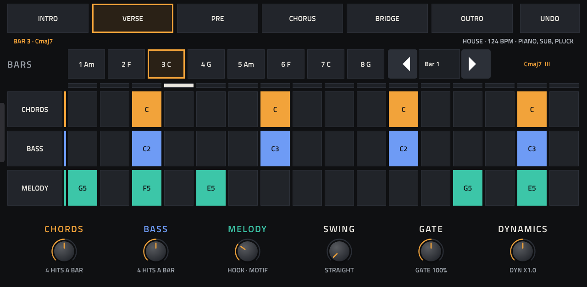
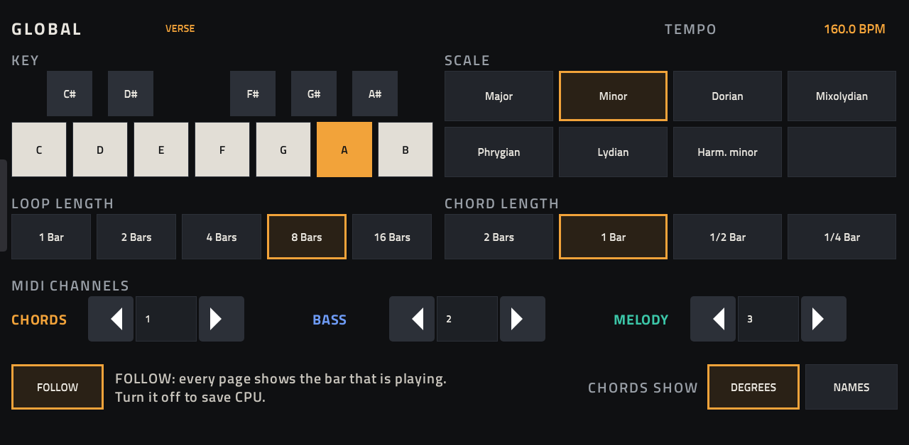
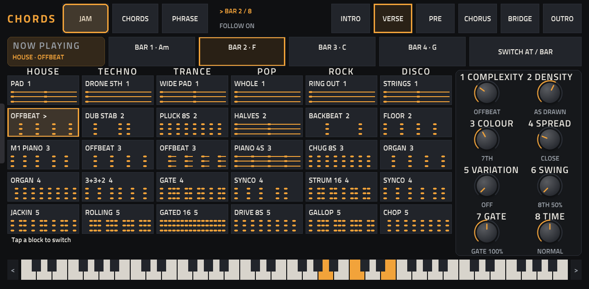
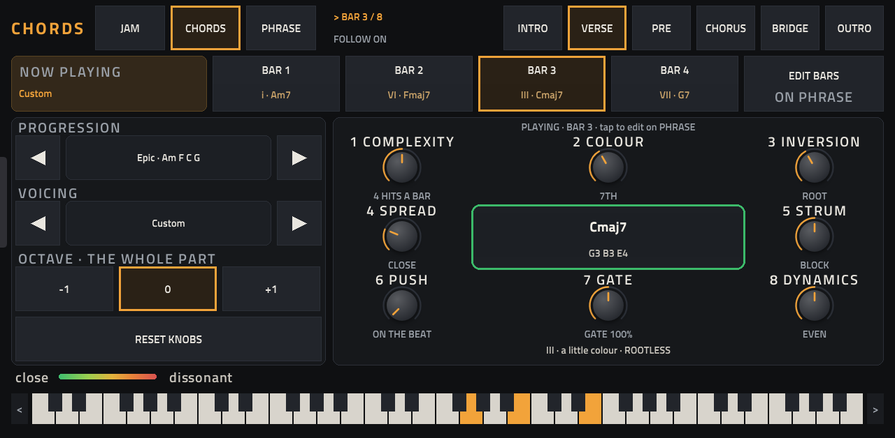
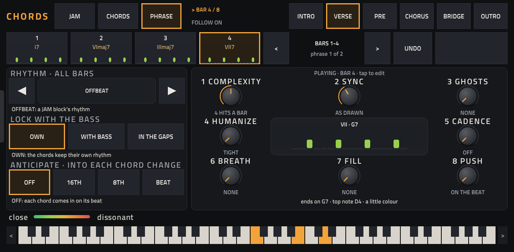
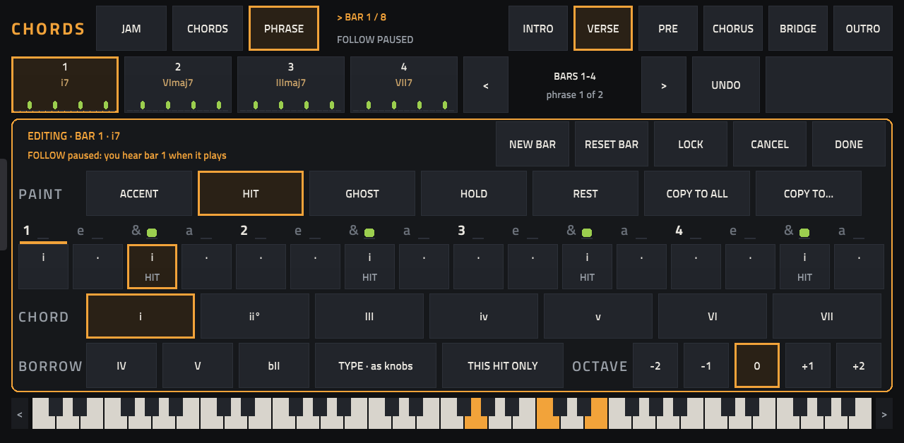
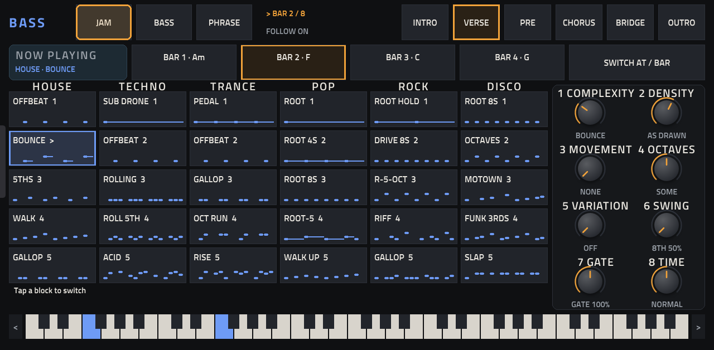
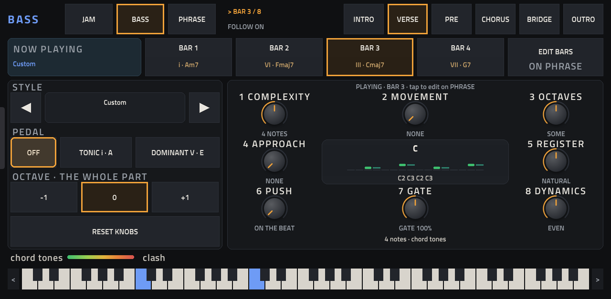
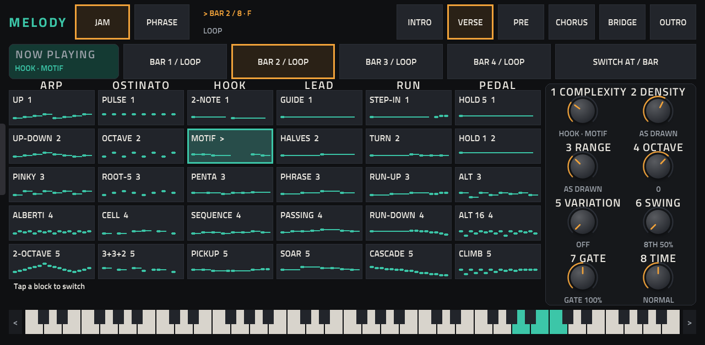
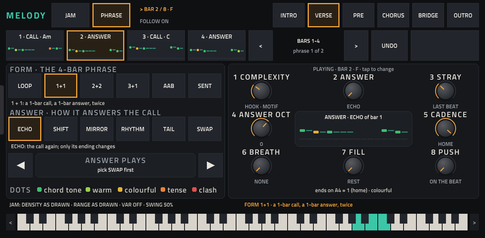

# Cadenza 0.26.0

**A chord-driven generative MIDI sequencer for the Akai Force.** Cadenza is a native VST2 plugin that plays chords,
a bass line and a melody into three of your Force tracks. Pick a key, tap a block, turn a knob: it writes the parts,
keeps them in key, and changes them in time with the music while it plays.

**[cadenzajam.com](https://cadenzajam.com)** has a walkthrough and a version that runs in the browser. The full
manual is **[MANUAL.md](MANUAL.md)**.

Called Chord Seq until 0.25.0. The plugin's ID (`ChSq`) kept the old name, so projects saved with Chord Seq still open.

---

## Contents

- [Screenshots](#screenshots)
- [Features](#features)
- [Requirements](#requirements)
- [Install](#install)
- [Your first groove in 60 seconds](#your-first-groove-in-60-seconds)
- [The pages](#the-pages)
- [Troubleshooting](#troubleshooting)
- [Specifications](#specifications)
- [Documentation](#documentation)
- [Building and tests](#building-and-tests)
- [Credits and licence](#credits-and-licence)

---

## Screenshots

Taken on an Akai Force (MPC OS 3.9.1) running Cadenza 0.26.0, playing the House 124 preset.

| | |
|---|---|
| **PLAY**: the song parts, the bars, three lanes of steps | **GLOBAL**: key, scale, loop, MIDI channels |
|  |  |
| **CHORDS · JAM**: tap a block to change the chords' rhythm and feel | **CHORDS**: progression, voicing and eight knobs |
|  |  |
| **CHORDS · PHRASE**: the bars, their rhythm and locks | **CHORDS · bar editor**: hits, chords, octaves |
|  |  |
| **BASS · JAM** | **BASS**: style, pedal and eight knobs |
|  |  |
| **MELODY · JAM**: six kinds of melody, five blocks each | **MELODY · PHRASE**: call and answer |
|  |  |

The manual has more screens: every editor, browser and picker.

---

## Features

### Three parts that listen to each other

- **Chords, bass and melody**, each on its own MIDI channel (1, 2 and 3 to start), each driving any Force track you
  like: a stock synth, a sampler, a plugin or external gear.
- **The bass and the melody follow the chords that play**, borrowed chords, sus chords and chord changes in the middle
  of a bar included. Their notes come from the key and the chord that plays, unless you pick a note yourself.
- **Nothing is random.** The same blocks, knobs and edits always give the same notes, so a part you like comes back
  exactly when you reload the project.

### Jam it live

- **JAM pages** on every part: 30 blocks in six columns, from simple (top) to busy (bottom). CHORDS and BASS have
  HOUSE, TECHNO, TRANCE, POP, ROCK and DISCO. MELODY has ARP, OSTINATO, HOOK, LEAD, RUN and PEDAL.
- **Switches land in time.** A block takes over at the next beat, bar, 2 bars or phrase (SWITCH AT), counted from the
  song position. The loop never restarts.
- **Eight knobs per page**, mapped to the Force's eight Q-Link knobs. They follow the page you are on: COMPLEXITY,
  DENSITY, SWING, GATE, TIME and more, each showing what it does in words, not numbers.

### Shape it bar by bar

- **Chords:** 16 progressions, the scale's chords plus three borrowed from the parallel scale, chord types (sus2,
  sus4, add9, 6), 52 voicing styles in 13 genres, colour from power chords to 13ths, inversion, spread and strum.
- **Bass:** 48 named styles in 12 genres, a tonic or dominant pedal, movement, octaves, approach notes and register.
- **Melody:** call and answer in six forms (LOOP, 1+1, 2+2, 3+1, AAB, SENTENCE) with six kinds of answer (ECHO,
  SHIFT, MIRROR, RHYTHM, TAIL, SWAP), plus breath, cadence and fills.
- **PHRASE pages:** paint each bar's hits (ACCENT, HIT, GHOST, HOLD, REST), pick each hit's chord or note and octave,
  copy a bar to others, lock bars, and give a bar a fresh line of its own (NEW BAR). Up to four chord changes a bar.
- **Lock the parts together:** chords and bass can hit together (WITH) or fill each other's gaps (IN THE GAPS), and
  either can anticipate each chord change by a 16th, an 8th or a beat.

### Songs

- **Six song parts:** INTRO, VERSE, PRE, CHORUS, BRIDGE and OUTRO. Each part is its own loop (1 to 16 bars) with
  its own chords, lines and mutes. Tap a part while playing and it comes in at the next bar line.
- **Genre presets** in MPC's PRESET menu: House 124, Techno 130, Trance 138, Pop 110, Rock 120 and Disco 118, each
  filling all six parts, and Init, a plain C major start.
- **Saved with your project**, along with all six parts, every edit and lock. UNDO steps back through your changes.

---

## Requirements

- An **Akai Force** (first generation), MPC OS 3.x. Cadenza is built for the Force's 32-bit ARM chip and tested on a
  Force with MPC OS 3.9.1. The installer also runs on other first-generation MPC OS devices (MPC Live, Live II, One, X,
  Key 61), but they are untested.
- **Root SSH access** to the device, which needs a modded unit (for example MockbaMod). Stock MPC OS can't load
  third-party plugins. Installing this way is unofficial: back up first, at your own risk.
- Instrument tracks for the three parts. Cadenza makes MIDI only, no sound.

---

## Install

1. Download the release zip (`Cadenza-0.26.0-mpc-armv7.zip`) and unzip it on your computer.
2. **Save your project.** The installer stops and restarts MPC.
3. Copy the folder to the device and run the installer:

   ```
   scp -r Cadenza-0.26.0 root@<device-ip>:/tmp/
   ssh root@<device-ip> sh /tmp/Cadenza-0.26.0/install.sh
   ```

The installer copies the plugin to `/sdcard/Synths/Cadenza - VST - Cadenza/`, backs up `MPC.settings`, adds Cadenza to
MPC's plugin list and starts MPC again. Running it again upgrades in place. `uninstall.sh` in the same folder removes
it. The zip's `INSTALL.md` also has the steps for installing by hand.

---

## Your first groove in 60 seconds

1. **Load Cadenza:** make a plugin track, open MENU › TRACK EDIT, tap PLUGIN and pick **VST › Cadenza**.
2. **Make three tracks to play:** pads, bass and a lead, with any sounds you like.
3. **Wire them:** on each of the three, set **INPUT PORT** to **Cadenza MIDI Out** and **INPUT CHANNEL** to 1 (chords),
   2 (bass) or 3 (melody).
4. **Give Cadenza a clip:** make a 16-bar clip on the Cadenza track. Cadenza plays only while a clip plays on its track.
5. **Pick a start:** tap PRESET and choose a genre (or Init).
6. **Play the clip.** The three parts play on their three tracks. Open CHORDS, BASS or MELODY and tap blocks on JAM.

The [manual's setup chapter](MANUAL.md#3-set-up-a-project) covers each step, and what to do if the port isn't listed.

---

## The pages

Cadenza's screen has five tabs along MPC's tab strip. CHORDS, BASS and MELODY each have their own pages, picked at the
top left.

| Tab | Pages | What it's for |
|---|---|---|
| **PLAY** | | The song parts, the bars, all three lanes' steps, mutes, UNDO, six performance knobs |
| **CHORDS** | JAM · CHORDS · PHRASE | Jam the chords' rhythm; set the progression and voicing; edit each bar |
| **BASS** | JAM · BASS · PHRASE | Jam the bass; set its style and pedal; edit each bar |
| **MELODY** | JAM · PHRASE | Jam the melody; set its call and answer; edit each bar |
| **GLOBAL** | | Key, scale, loop length, chord length, MIDI channels, FOLLOW, chord names |

Every page is covered control by control in [MANUAL.md](MANUAL.md).

---

## Troubleshooting

| Problem | Fix |
|---|---|
| Nothing plays | Cadenza plays only while a clip plays on its own track. Make one and play it. |
| A track stays silent | Check the track's INPUT PORT (Cadenza MIDI Out) and INPUT CHANNEL against GLOBAL's MIDI CHANNELS, and that the lane isn't muted on PLAY. |
| Cadenza MIDI Out isn't listed | In Preferences › MIDI, turn on **Enable Track** for the Cadenza port. |
| Playback stops after a while | MPC stopped at its sequence end (128 bars in a new sequence). Turn on the sequence loop. |
| A long part restarts early | The clip, or the ARRANGE loop, is shorter than the part's loop. Make it at least as long (16 bars covers every length). |
| Knobs show the wrong names | The project was saved with an older Cadenza, and MPC replays the old knob map. Start a new project. |

More in the [manual's troubleshooting chapter](MANUAL.md#21-troubleshooting).

---

## Specifications

| | |
|---|---|
| Format | VST2 instrument (MIDI out only), with its own MPC skin |
| Device | Akai Force, first generation (armv7, 32-bit), MPC OS 3.x |
| MIDI out | Its own ALSA port, **Cadenza MIDI Out**: one channel per part (1–16, default 1, 2, 3) |
| Parts | Chords, Bass, Melody |
| Song parts | 6 (Intro, Verse, Pre, Chorus, Bridge, Outro), each 1, 2, 4, 8 or 16 bars |
| Timing | 16 steps a bar, placed from MPC's song position; follows MPC's tempo |
| Keys and scales | 12 keys; Major, Minor, Dorian, Mixolydian, Phrygian, Lydian, Harmonic minor |
| Presets | Init and 6 genre presets in MPC's PRESET menu |
| CPU | p99 42.1 % of one audio block, worst block 58.7 %, in the toolchain bench's worst-case knob sweep on the Force |
| Plugin ID | `ChSq` |

---

## Documentation

- **[MANUAL.md](MANUAL.md)**: everything Cadenza does, page by page and knob by knob, with a cheat sheet.
- **[cadenzajam.com](https://cadenzajam.com)**: a step-by-step setup walkthrough on the Force, and the browser version.

---

## Building and tests

Builds run in Docker with the [mpc-vst-plugins](https://github.com/sd88me/mpc-vst-plugins) toolchain, checked out next
to this repo (or set `MPC_VST` to its path). Use the branch `chordseq/on-no-update` of
[Shrekage2024/mpc-vst-plugins](https://github.com/Shrekage2024/mpc-vst-plugins/tree/chordseq/on-no-update): it adds
three wrapper options that `vst/vst.json` turns on. Without them the plugin still builds, but it asks MPC for a redraw
about five times a second while playing.

```
vst/build.sh          # cadenza.so, the skin and the plugin-list entry in vst/build/, then the size budget check
tests/run_tests.sh    # offline tests under ASan/UBSan; needs vst/build.sh first; must end with PASSED
```

`src/` is the sequencer engine (no host or ALSA code). `src/engine.c` connects it to the toolchain's VST2 wrapper and
opens the MIDI port. `vst/make_skin.py` generates the skin.

---

## Credits and licence

Cadenza is built with the MIT-licensed [mpc-vst-plugins](https://github.com/sd88me/mpc-vst-plugins) toolchain and
VST2 wrapper by sd88me and contributors. Full credits and third-party licences are in [CREDITS.md](CREDITS.md).

[PolyForm Shield 1.0.0](LICENSE): free to use, study, modify and share for any purpose except building a product that
competes with Cadenza. See [NOTICE](NOTICE).
